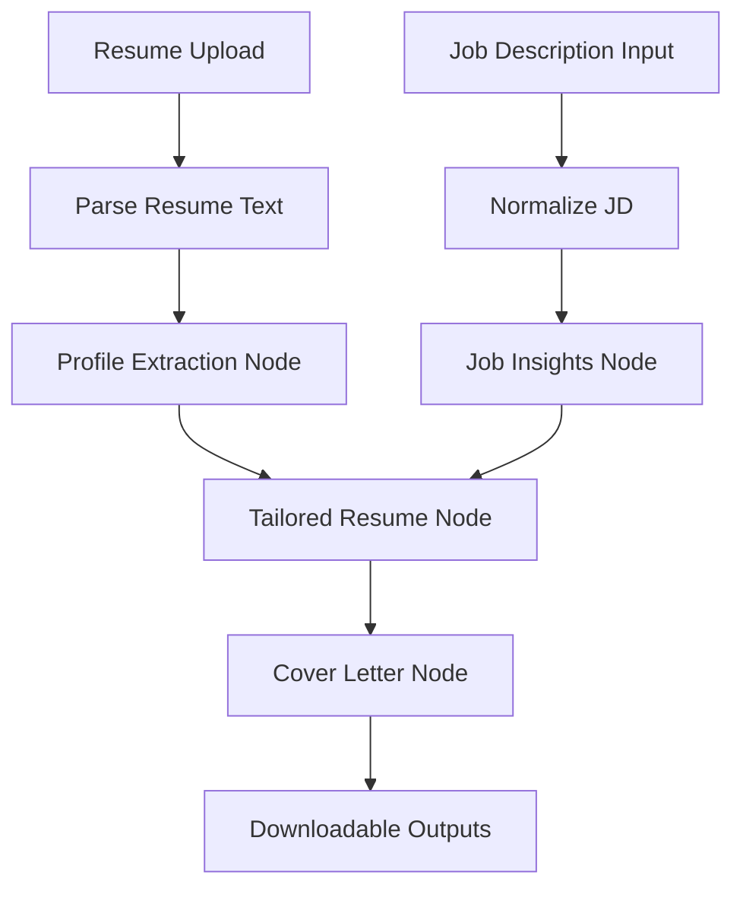

# Agentic CV Tailoring Pipeline Architecture

## Component Overview

- **Resume Upload & Parsing**: Streamlit handles file intake and `app.utils.parser` extracts clean text from PDF, DOCX, DOC, or TXT resumes.
- **Job Description Normalisation**: Trims whitespace to standardise prompts for the agentic flow.
- **LangGraph Orchestration**: `TailoringPipeline` wires four nodes (`profile`, `job`, `tailor`, `cover`) ensuring deterministic progression from raw text to deliverables.
- **LLM Driven Reasoning**: Each node leverages GPT-4o mini (configurable) through LangChain prompts to transform state.
- **Formatting Layer**: `app.utils.formatter` renders ATS-aligned DOCX downloads and plain-text previews for resumes and cover letters.
- **Streamlit Experience**: `streamlit_app.py` coordinates uploads, pipeline execution, previews, insights, and download buttons.
